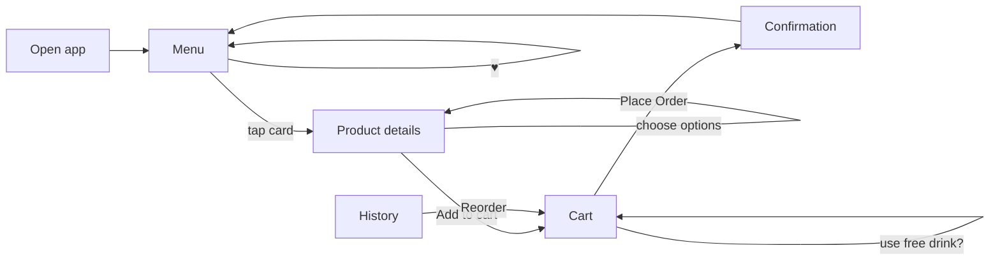
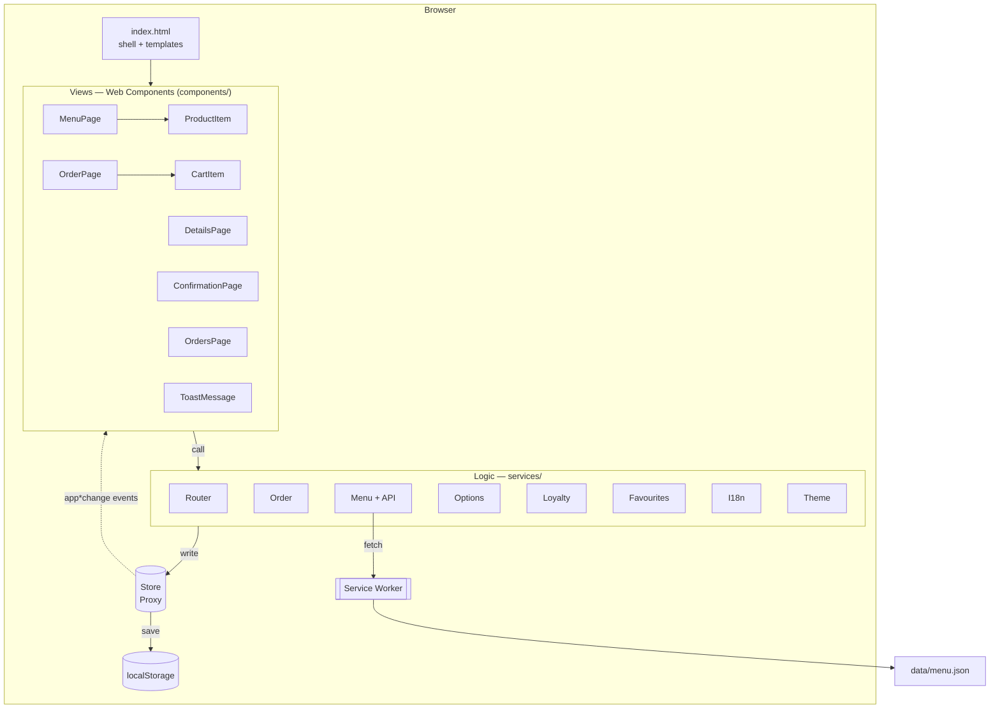
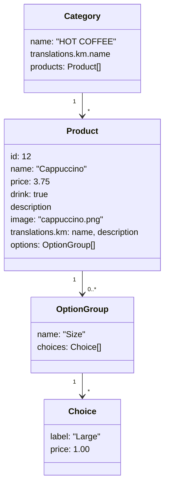

# Coffee Masters — Project Guide

A coffee-shop ordering app built with **plain HTML, CSS and JavaScript**: no
framework, no build step, no backend. This guide explains what we are going to
build, why it is designed the way it is, and the order we will build it in.

> Start from the `starter` branch (markup, styles and data are ready).
> The finished app is on `main`.

---

## 1. The project in one page

| | |
|---|---|
| **What** | A mobile-first web app where customers browse a coffee menu, customise drinks, place orders and collect loyalty points |
| **Who uses it** | Coffee-shop customers, on phones first and desktops second |
| **Tech** | HTML templates, CSS custom properties, JavaScript modules, Web Components, History API, localStorage, Service Worker |
| **Runs on** | Any static web server (VS Code Live Server in class) |
| **Data** | `data/menu.json`: 4 categories, 11 products, option groups, Khmer translations |
| **Tested with** | Playwright: 100 end-to-end tests on the finished app |

### Goals
1. Learn how a real single-page app works **without** a framework hiding it.
2. Practise splitting an app into **views** (components), **logic** (services) and **state** (store).
3. Ship something that feels like a real product: responsive, accessible, bilingual, installable and usable offline.

### Constraints
- No frameworks or libraries in the app itself (Playwright is only for tests).
- No server-side code: the menu is a static JSON file and everything else lives in the browser.
- Must work when served by a plain static host.

### Out of scope
Payments, user accounts, a real order backend, and live order status. These
are good follow-up projects once the frontend is done.

---

## 2. Requirements (system analysis)

### 2.1 Actors
| Actor | Goal |
|---|---|
| **Customer** | Find a drink, customise it, order it, reorder favourites, earn rewards |
| **Browser / device** | Stores the customer's cart, orders, points and preferences; caches the app for offline use |
| **Shop (future)** | Would receive orders; out of scope for this project |

### 2.2 Functional requirements

| ID | Requirement |
|---|---|
| **Menu** | |
| FR-01 | Show the menu grouped by category, loaded from `data/menu.json` |
| FR-02 | Each product card shows photo, name, price, an **Add** button and a ♥ favourite button |
| FR-03 | Search by product or category name (English or Khmer) |
| FR-04 | Filter by category with chips; search and category combine |
| FR-05 | Keep the filter in the URL (`/?q=cap&category=tea`) so reload and Back keep it |
| FR-06 | Show "No items match …" with a **Clear filters** button when nothing matches |
| **Product details** | |
| FR-07 | Open a product at `/product-{id}`, including by direct link or page refresh |
| FR-08 | Choose options (size, milk, extra shot); the price updates as you choose |
| FR-09 | Unknown product id shows "Product not found" |
| **Cart** | |
| FR-10 | Add from the menu (default options) or from details (chosen options) |
| FR-11 | Same product + same options merge into one line; different options are separate lines |
| FR-12 | Change quantity with − / +; − at 1 removes the line; 🗑 removes it |
| FR-13 | Show the item count as a badge on the Cart tab |
| FR-14 | Show a short toast: "Cappuccino added to cart" |
| FR-15 | The cart survives a page reload |
| **Checkout** | |
| FR-16 | Customer form: name (required), phone (required, 7–15 digits), email (optional, must be valid) |
| FR-17 | Show errors under each field when leaving it or submitting; focus the first invalid field |
| FR-18 | Placing an order empties the cart and shows a confirmation with an order number (#1001, #1002, …) |
| **History** | |
| FR-19 | List past orders newest first, with date, items and total (last 50 kept) |
| FR-20 | **Reorder** adds an old order's items to the cart at **today's** prices |
| **Favourites** | |
| FR-21 | ♥ toggles a favourite; favourites appear in a section at the top of the menu |
| **Loyalty** | |
| FR-22 | Earn 1 point per whole dollar paid |
| FR-23 | At 50 points, offer a free drink: the most expensive drink in the cart (options included), opt-in |
| **Preferences** | |
| FR-24 | Switch between English and Khmer; remembered; first visit follows the browser language |
| FR-25 | Switch between light and dark theme; remembered; first visit follows the system |
| **Offline** | |
| FR-26 | After the first visit, the app opens and works without a network |

### 2.3 Non-functional requirements

| Area | Requirement | How we check it |
|---|---|---|
| Responsive | Works from 320 px phones to desktop; bottom tab bar on phones | Screenshots at 320 / 390 / 1280 px |
| Accessibility | Text contrast ≥ 4.5:1 (WCAG AA) in both themes; labelled controls; visible focus; keyboard use | Automated contrast test, `getByRole` / `getByLabel` in tests |
| Performance | Each stylesheet and `menu.json` downloaded once; images lazy-loaded | Request-counting tests |
| Resilience | Broken or missing saved data never crashes the app | Tests with corrupted `localStorage` |
| Security | User input (e.g. a name) is shown as text, never as HTML | Test that tries to inject `` |
| Portability | Any static host; deep links and refresh work | Tests against a server with no SPA fallback |
| Maintainability | One job per file; no hard-coded colours; all UI text in dictionaries | Code review; dictionary completeness test |

### 2.4 Assumptions
- One customer per device: data is stored per browser, not per account.
- Prices are in US dollars and the menu changes rarely.
- The customer can type Khmer or English into the form.

---

## 3. How a customer uses it



**Main scenario: order a customised drink**
1. The customer opens the app and sees the menu.
2. They search "cap" and tap **Cappuccino**.
3. They pick **Large** and **Oat**; the price changes from $3.75 to $5.35.
4. They tap **Add to cart** and land on the cart.
5. They enter a name and phone number and tap **Place Order**.
6. They see "Thank you, Alex! Order #1001" and "+5 points".

---

## 4. Architecture

### 4.1 The big picture



Three rules keep the code easy to follow:

1. **Views only display and forward clicks.** A component never calculates a
   price or saves data. It calls a service.
2. **Services own the rules.** Pricing, loyalty, validation and routing live in
   plain JavaScript modules that don't touch the page layout.
3. **State lives in one Store, and changes are broadcast.** Writing
   `app.store.cart = …` saves to `localStorage` and fires `appcartchange`.
   Any view that cares listens and re-renders itself.

### 4.2 Folder structure

```
index.html            Shell (header, <main>, footer) and one <template> per view
app.js                Wires everything together on DOMContentLoaded
components/           Web Components (views)
services/             Plain modules (logic and state)
styles/               global.css + shared.css + one stylesheet per page
data/menu.json        The menu
serviceworker.js      Offline support
tests/                Playwright tests + a tiny static server
```

### 4.3 Components (views)

| Component | Shows | Listens to |
|---|---|---|
| `MenuPage` | Greeting, search, chips, favourites and category grids | `appmenuchange`, `appfavouriteschange` |
| `ProductItem` | One product card (♥, photo, name, price, Add) | — |
| `DetailsPage` | Photo, description, option pickers, sticky price + Add bar | — |
| `OrderPage` | Cart summary, loyalty card, customer form | `appcartchange` |
| `CartItem` | One cart line: thumbnail, options, stepper, price, delete | — |
| `ConfirmationPage` | Check mark, receipt, total, points earned | — |
| `OrdersPage` | Past orders with Reorder buttons, points balance | — |
| `ToastMessage` | Short status messages (a live region) | `apptoast` |

Each page component uses **Shadow DOM**. Its styles come from
`styles/shared.css` plus its own stylesheet, adopted with `adoptedStyleSheets`
so each file is downloaded and parsed only once.

### 4.4 Services (logic)

| Service | Responsibility |
|---|---|
| `API` | Fetch `menu.json` |
| `Menu` | Load the menu once (shared promise), find a product by id |
| `Store` | The single state object (Proxy): saves to `localStorage`, fires events |
| `Router` | Map URLs to views, History API, active tab |
| `Order` | Add / remove / change quantity, totals, place order, reorder |
| `Options` | Resolve defaults, price a choice, build cart-line keys and labels |
| `Loyalty` | Points earned, reward eligibility, discount |
| `Favourites` | Toggle and check favourites |
| `I18n` | Dictionaries, `t()`, translate templates, dates |
| `Theme` | Read / set theme, follow the system |
| `Styles` | Load each stylesheet once, adopt into shadow roots |

---

## 5. Data design

### 5.1 Menu (`data/menu.json`)



- The **first choice** of each group is the default and costs nothing extra.
- Coffees have Size, Milk and Extra shot; teas have Size; snacks have no options.
- `drink: true` marks products that can be the free loyalty drink.

### 5.2 Cart line and order

```js
// A cart line
{
    key: "12|Size=Large|Milk=Oat",   // product id + non-default choices
    product: { ...Product },          // snapshot at the time it was added
    options: { Size: "Large", Milk: "Oat", "Extra shot": "No" },
    unitPrice: 5.35,                  // 3.75 + 1.00 + 0.60
    quantity: 1
}

// An order
{
    number: 1001,
    placedAt: "2026-09-28T15:59:00.000Z",
    customer: { name, phone, email },
    items: [ /* cart lines */ ],
    subtotal, discount, total,
    pointsUsed, pointsEarned, pointsBalance
}
```

The **key** is what makes "same drink, same options" merge into one line. It
only lists non-default choices, so a plain Cappuccino's key is just `"12"`.

### 5.3 What the browser stores

| Key | Holds |
|---|---|
| `cm-cart` | Current cart lines |
| `cm-orders` | Past orders (newest first, max 50) |
| `cm-last-order` | The order shown on the confirmation page |
| `cm-order-number` | Last order number used |
| `cm-favourites` | Favourite product ids |
| `cm-points` | Loyalty points balance |
| `cm-language` | `"en"` or `"km"` |
| `cm-theme` | `"light"` or `"dark"` (absent = follow system) |

Every read is wrapped in `try/catch` with a fallback, so private browsing or
corrupted data gives an empty cart instead of a broken app.

### 5.4 Events

| Event | Fired when | Who reacts |
|---|---|---|
| `appmenuchange` | The menu finished loading | `MenuPage` |
| `appcartchange` | The cart changed | `OrderPage`, cart badge |
| `appfavouriteschange` | A favourite was toggled | `MenuPage` |
| `apptoast` | Something should be announced | `ToastMessage` |
| `applanguagechange` | Language switched | `app.js` re-renders the current page |
| `appthemechange` | Theme switched (or system changed) | Theme button |

---

## 6. Key design decisions

### 6.1 Routing with the History API

| URL | View |
|---|---|
| `/` | `MenuPage` (reads `?q=` and `?category=`) |
| `/product-{id}` | `DetailsPage` |
| `/order` | `OrderPage` |
| `/order/confirmed` | `ConfirmationPage` |
| `/orders` | `OrdersPage` |
| anything else | "Oups, 404!" |

Clicking a link calls `history.pushState` and swaps the view without a page
load. **But a refresh asks the server for `/product-12`**, a file that does
not exist. Two fixes:

- Tell the server to answer unknown paths with `index.html`
  (`.vscode/settings.json` → `"liveServer.settings.file": "index.html"`).
- The service worker serves the cached app when the server answers 404.

All asset paths in `index.html` are absolute (`/app.js`, `/styles/…`) so
nested routes such as `/order/confirmed` still load them.

### 6.2 Pricing and options

```
unit price = product price + price of each chosen option
Cappuccino, Large, Oat = 3.75 + 1.00 + 0.60 = $5.35
```

Choices are stored in **English** (`"Large"`) as identifiers and only
translated when displayed, so switching language never breaks a saved cart.

### 6.3 Checkout validation

| Field | Rule | Message |
|---|---|---|
| Name | Not blank | Please enter your name |
| Phone | Required; digits, spaces, dashes, optional leading `+`; 7–15 digits | Please enter your phone number / a valid phone number |
| Email | Optional; must be a valid address if filled | Please enter a valid email address |

Errors appear when a field is left (if it has a value) and on submit. Space is
reserved under each field so an error appearing never moves the button away
from the cursor.

### 6.4 Loyalty rules

```
points earned = floor(amount actually paid)
free drink    = 50 points → price of the most expensive drink line (one unit)
```

- The reward is **opt-in** (a checkbox), so customers can save points.
- Snacks can't be the free drink.
- Points are earned on the amount paid **after** the discount.

Example: 50 points, cart = Large Cappuccino $5.35 + 2 Croissants $5.60.
Using the reward: total $5.60, points 50 − 50 + 5 = **5**.

### 6.5 Translation (English / Khmer)

- UI text lives in two dictionaries in `services/I18n.js`; `t("key", { name })`
  fills in values.
- HTML templates mark text with `data-i18n="key"`. The templates themselves are
  translated, so every component clones text that is already in the right
  language.
- Menu names and descriptions come from `translations.km` in `menu.json`,
  falling back to English.
- Search matches both languages. `<html lang>` switches so screen readers
  pronounce Khmer correctly, and Noto Sans Khmer is used for Khmer text.
- A test fails if a key exists in one language but not the other.

### 6.6 Theming

- All colours are **named by purpose** (`--surface`, `--text-muted`,
  `--primary`, `--accent` …) in `styles/global.css`.
- Dark mode redefines those tokens: under `prefers-color-scheme: dark` when
  the user hasn't chosen, and under `[data-theme="dark"]` when they have.
- A tiny inline script in `<head>` applies a saved theme **before** the page
  paints, so there is no white flash.

### 6.7 Offline (Service Worker)

| Request | Strategy | Why |
|---|---|---|
| Page navigation | Network first → cached app shell (also on 404) | Fresh when online; routes work offline and on plain hosts |
| Code, CSS, `menu.json` | Network first → cache | Always the latest prices and code when online |
| Images | Cache first | They rarely change |
| Google Fonts | Cache first | Icons must render offline |

On install it **precaches** every file. Bump `CACHE = "coffeemasters-vN"`
whenever that list changes so old caches are cleaned up.

---

## 7. Design system

| Token | Light | Dark | Used for |
|---|---|---|---|
| `--background` | `#FAF7F2` | `#171210` | Page |
| `--surface` | `#FFFFFF` | `#221A15` | Cards |
| `--text` | `#1F1611` | `#F3ECE4` | Main text |
| `--text-muted` | `#6B5B4E` | `#BFAE9E` | Secondary text |
| `--primary` | `#3B2416` | `#E0B284` | Buttons |
| `--accent` | `#9A5420` | `#E7B98A` | Prices, highlights |
| `--header` | `#2A1A10` | `#120D0B` | Header and footer |

- **Type:** Plus Jakarta Sans (Latin), Noto Sans Khmer (Khmer), Material Symbols (icons).
- **Shape:** 14 px / 22 px radius, pill buttons and chips, soft shadows.
- **Layout:** product grid (2 columns on phones, up to 5 on desktop); tabs in
  the header on desktop and in a bottom bar under 720 px.

---

## 8. Build roadmap

Each milestone ends with something you can click. Build them in order: later
milestones rely on earlier ones.

| # | Milestone | You build | You learn | Covers |
|---|---|---|---|---|
| 0 | **Starter** | Nothing yet: explore `index.html`, `styles/`, `menu.json` | Project layout, templates, CSS tokens | — |
| 1 | **Menu from JSON** | `API`, `Menu`, `Store`, `MenuPage`, `ProductItem` | Modules, `fetch`, Web Components, `<template>`, Shadow DOM | FR-01, 02 |
| 2 | **Routing** | `Router`, `DetailsPage`, 404 | History API, `pushState` / `popstate`, deep links, server fallback | FR-07, 09 |
| 3 | **Cart** | `Order`, `OrderPage`, `CartItem`, badge | Proxy-based store, custom events, re-rendering | FR-10, 13 |
| 4 | **Checkout** | Form validation, `placeOrder`, `ConfirmationPage` | Forms, accessible errors, focus management | FR-16, 17, 18 |
| 5 | **Polish the cart** | Save to `localStorage`, − / + stepper, toast | Persistence, defensive parsing, live regions | FR-12, 14, 15 |
| 6 | **Find things faster** | Search, category chips, URL filter state, favourites | `URLSearchParams`, `replaceState`, focus restoration | FR-03, 04, 05, 06, 21 |
| 7 | **Product options** | Option pickers, pricing, cart-line keys | Data modelling, derived state | FR-08, 11 |
| 8 | **Order history** | `OrdersPage`, reorder | Lists, dates, re-pricing from current data | FR-19, 20 |
| 9 | **Loyalty points** | `Loyalty`, reward checkbox, points messages | Business rules, rounding money | FR-22, 23 |
| 10 | **English / Khmer** | `I18n`, `data-i18n`, menu translations | Internationalisation, fonts, `lang` | FR-24 |
| 11 | **Dark mode** | Tokens, `Theme`, toggle, no-flash script | CSS custom properties, `prefers-color-scheme`, contrast | FR-25 |
| 12 | **Offline** | `serviceworker.js`, registration | Service Worker lifecycle, caching strategies, PWA | FR-26 |

**Testing runs alongside every milestone.** Write a Playwright test for each
requirement as you finish it: the finished app has 100 of them.

---

## 9. Definition of done

A milestone is done when:

- [ ] Every requirement it covers works in the browser (phone and desktop width).
- [ ] It works in **both** themes and **both** languages (from milestone 10–11 on).
- [ ] Refreshing any page keeps you on that page.
- [ ] The browser console shows no errors.
- [ ] Keyboard-only use works: you can reach and use every control.
- [ ] Its Playwright tests pass.

---

## 10. Glossary

| Term | Meaning |
|---|---|
| **SPA** | Single-page app: one HTML page whose content JavaScript swaps as you navigate |
| **Web Component** | A custom HTML element (`<menu-page>`) defined with a JavaScript class |
| **Shadow DOM** | A component's private DOM, so its styles don't leak in or out |
| **Proxy** | A JavaScript object that runs code whenever a property is set, used for our Store |
| **Service Worker** | A script that sits between the page and the network and can answer from a cache |
| **Design token** | A named value such as `--surface`, reused instead of a raw colour |
| **WCAG AA** | The accessibility level we target: e.g. 4.5:1 text contrast |
